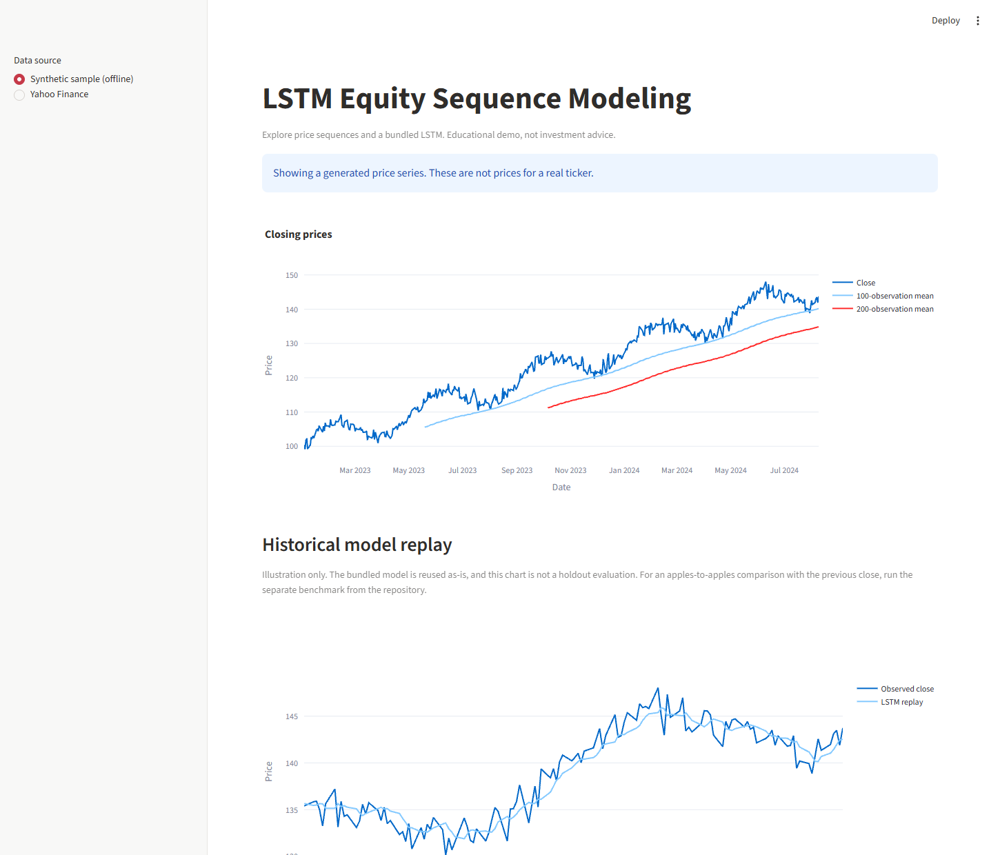

# LSTM Equity Sequence Modeling

Explore closing-price sequences with a Streamlit demo, then train a fresh LSTM
and compare it with a **previous-close baseline**. The demo opens on synthetic
data and works without a market data connection or an API key after installation.

**[Interactive demo](https://lstm-stock-price-predictor.streamlit.app/)** ·
**[Run the benchmark locally](#reproduce-the-holdout-benchmark)**



## Quick start

Use **Python 3.12** on 64-bit Windows or Linux, or on Apple Silicon macOS,
matching [`.python-version`](.python-version).
Install the dependencies from [`requirements.txt`](requirements.txt).

```sh
git clone https://github.com/0xmrpinheiro/lstm-equity-sequence-modeling.git
cd lstm-equity-sequence-modeling
```

**macOS / Linux**

```sh
python3.12 -m venv .venv
.venv/bin/python -m pip install -r requirements.txt
.venv/bin/python -m streamlit run streamlit_app.py
```

**Windows PowerShell**

```powershell
py -3.12 -m venv .venv
.\.venv\Scripts\python.exe -m pip install -r requirements.txt
.\.venv\Scripts\python.exe -m streamlit run streamlit_app.py
```

Open `http://localhost:8501`. The bundled Keras model is loaded automatically.
Choose **Yahoo Finance** in the sidebar to download adjusted daily prices for
a ticker. The end date is exclusive. No download is required for the sample.

## Demo versus benchmark

The app shows a **historical replay**, not measured forecasting skill. It reuses
the bundled model and adapts the input scale using an initial portion of the
selected history. The resulting chart does not establish that the model
generalizes to another ticker or time period. The app does not present replay
errors or a multi-day projection as a performance result.

## Reproduce the holdout benchmark

From the repository root with the virtual environment active, run the offline
example first:

```sh
python -m Models.neural_network_forecaster --sample --epochs 1
```

Then use a fixed CSV (`Date` and `Close` columns) or download a specified date
range. Save the CSV if you need to reproduce the same observations later.

```sh
python -m Models.neural_network_forecaster --csv prices.csv
python -m Models.neural_network_forecaster --ticker MSFT --start 2000-01-01 --end 2024-10-23
```

1. Split the series in chronological order: 70% training, 15% validation, 15% test.
2. Fit the scaler on training closes only. Each prediction uses the preceding
   100 closes. Validation selects when to stop training.
3. Compare one-step MAE and RMSE for the new LSTM and the previous-close
   baseline on the same holdout dates. Each test step may use earlier observed
   holdout closes; this is not a recursive multi-step forecast.

The benchmark does not use or replace the bundled artifact. To keep a newly
trained model, pass `--output` with a new `.keras` path. Synthetic scores only
check the workflow. No results here establish investment performance.

## Tests

```sh
python -m unittest discover -s tests -v
```

The app smoke test loads the bundled model and renders the offline example.
CI also trains for one epoch and verifies that the benchmark runs without
Yahoo Finance. Licensed under [GPL-3.0](LICENSE).